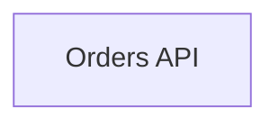

# Mermade

A fast, private Mermaid diagram editor that runs entirely in your browser. There's no server and no account, and nothing you draw leaves your machine unless you share it.

## Features

- **Editor:** CodeMirror 6 with Mermaid syntax highlighting, keyword autocomplete, find/replace, folding, multi-cursor and undo history per diagram.
- **Live preview:** re-renders as you type. Syntax errors are underlined on the offending line, and the last good render stays visible while you fix them.
- **Preview controls:** pan by dragging or scrolling, zoom with Ctrl/⌘ + scroll or the + / − / 0 / 1 keys, fit to screen, and fullscreen.
- **Diagram library:** create, rename, duplicate, search and delete diagrams. Deleting can be undone. Everything autosaves to IndexedDB and stays in sync across open tabs.
- **Templates:** flowchart, sequence, class, state, ER, Gantt, pie, mindmap, timeline, user journey, git graph, quadrant and XY chart, each shown with a live thumbnail.
- **Import** from the file picker, by dragging files anywhere onto the window, or by pasting:
  - `.mmd` / `.mermaid` / `.txt` files
  - Markdown (`.md`): every ` ```mermaid ` block becomes its own diagram
  - SVGs exported from Mermade, which embed their source
  - `.json` backups
  - share links, including **mermaid.live** `#pako:` links
- **Export:**
  - PNG at 1–4× with a transparent, white or dark background
  - SVG, which embeds its source so you can re-import and edit it
  - copy PNG or SVG to the clipboard
  - `.mmd` or Markdown, as a download or copied
  - share links. The whole diagram is stored in the URL, in the same format mermaid.live uses.
  - a JSON backup of all diagrams
- **Big-diagram tools (flowcharts):**
  - **Focus:** click a node or group to highlight everything it connects to and fade the rest. You can pick the depth (1, 2, 3 or all hops) and the direction (both, downstream or upstream).
  - **Isolate:** redraw just that neighbourhood, so you get a small, clean layout of the part you care about.
  - **Collapse groups:** turn any subgraph into a single box, or collapse all top-level groups for an overview. Parallel links between collapsed groups merge into one, labelled with a count ("5 links").
  - **Find:** search a node or group by name and zoom to it. Collapsed groups open automatically to reveal it.
  - **Code ↔ diagram linking:** selecting something in the diagram highlights its definition in the code, and moving the cursor in the code highlights the matching nodes in the diagram.
- **Visual editing (flowcharts):** edits are written back into your Mermaid code with targeted patches, so your formatting and comments are kept.
  - Rename nodes, groups and connection labels in the inspector.
  - Drag a node onto a group to move it in, or onto empty space to move it out. You can also drag a group by its title.
  - Alt-drag (or Shift-drag) from one node to another to connect them, or use the inspector's connect button.
  - Delete or reverse connections, delete nodes, add nodes, wrap nodes in a new group, or ungroup.
  - Visual edits have their own undo: the Undo button in the toast, or Ctrl/⌘ + Z with the preview focused.
- **Design:**
  - One-click presets: Modern, Soft, Outline, Blueprint, Neon, Nord, Sketch, Terminal and Classic.
  - Mix and match a structural style (modern, soft, outline, glow or classic) with any of 14 palettes, or build your own palette with custom colours.
  - Colour by group: each top-level subgraph gets its own accent colour.
  - Choose the font, line style (rounded, smooth, straight or step), spacing, hand-drawn rendering, and the ELK layout engine, which usually untangles busy graphs.
  - The design is saved per diagram, and exports include it.
- **Responsive:** on phones, you switch between Code and Preview with tabs.
- **Node links and health checks:** select a node to see its URLs in the inspector. **Check links** puts a status dot on each linked node.

## Node links & health checks

Attach URLs to flowchart nodes with Mermaid's own `click` syntax. The click URL is labelled PRD. Put extra URLs in the tooltip as `Label: https://…` segments separated by `|`:



When you select a node, the inspector lists its links. **Check links** (in the toolbar) requests each URL once from your browser. A dot then appears at the top right of each linked node:

| Dot | Meaning |
|---|---|
| Green | Every URL answered |
| Amber | Some URLs answered |
| Red | No URL answered |
| None | Not checked yet |

What a check can and cannot tell you:

- **A check tests whether a URL is reachable, not whether the service is healthy.** Requests are `no-cors`, so the response is opaque and an HTTP 500 still counts as up. Down means a DNS, connection or TLS error, or no answer within the timeout.
- **A check shows what *you* can reach.** Private hosts need your VPN. Chrome's Local Network Access may block private hosts from a hosted mermade, so run it locally (`bun run dev`). On an `https://` page, `http://` URLs are blocked as mixed content and read as down.
- **Nothing runs on its own and nothing is stored.** Checks run only when you click, and the results disappear on reload or when you edit the diagram.

## Development

Requires [Bun](https://bun.sh) ≥ 1.2.

```sh
bun install
bun run dev        # dev server with hot reload
bun test           # unit tests
bun run typecheck
bun run build      # static production build → dist/
bun run preview    # serve dist/ at http://localhost:4173/mermade/ (like GitHub Pages)
```

Stack: Bun (bundler, dev server, test runner), React 19, Tailwind CSS 4, CodeMirror 6 and Mermaid. Mermaid is lazy-loaded, so the editor appears before the renderer finishes downloading. ELK is only fetched when a diagram uses it.

### How visual editing stays safe

`src/lib/flow/parse.ts` is a parser for flowcharts that records where every node, connection and group sits in the source text. It mirrors Mermaid's own rules, including which group a node belongs to and how connection IDs are generated. The tests in `tests/flow-*.test.ts` check it against Mermaid's real parser on a set of tricky diagrams, and check every edit operation the same way. As a final guard, the app cross-checks each flowchart against Mermaid's parser while it runs. If the two disagree, visual tools switch off for that diagram instead of risking a bad edit.

## Deploying to GitHub Pages

The build emits only relative URLs, so `dist/` works from any sub-path such as `https://<user>.github.io/<repo>/`. You don't need to configure a base path.

1. In the repo, go to **Settings → Pages → Build and deployment** and set **Source** to **GitHub Actions**.
2. Push to `main`, or run the **Deploy to GitHub Pages** workflow by hand from the Actions tab.

`.github/workflows/deploy.yml` type-checks, tests, builds and publishes `dist/`. A separate CI workflow runs the same checks on pull requests and other branches.

To host it somewhere else, upload the contents of `dist/` to any static file host.

## Project layout

```
index.html                 entry (Bun HTML bundling)
src/App.tsx                app shell: layout, state, actions, shortcuts
src/components/            Editor, Preview, Inspector & graph toolbar, Design panel, Sidebar, dialogs
src/lib/storage.ts         IndexedDB persistence + cross-tab sync + settings
src/lib/render.ts          serialized Mermaid rendering
src/lib/importer.ts        file / markdown / link import
src/lib/exporter.ts        SVG/PNG/Markdown export helpers
src/lib/share.ts           mermaid.live-compatible share links
src/lib/design.ts          styles, palettes and compiling them to Mermaid config
src/lib/flow/              flowchart parser, source edits, views (collapse/focus/isolate), SVG mapping
src/hooks/useGraph.ts      selection, focus, collapse and visual edits with undo
scripts/build.ts           production build
tests/                     bun test suites
```
